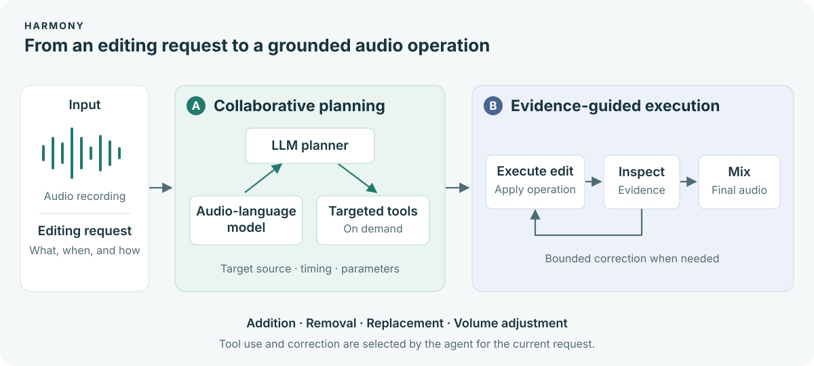

<div align="center">


# Harmony
### Bridging Audio Understanding and Editing through Agentic Collaboration

**Natural-language audio editing with collaborative planning and evidence-guided execution.**

[Audio Demo](https://christong9.github.io/harmony/) · [Quick Start](#quick-start) · [Method](docs/method.md) · [420-Example List](data/mmae_420.csv) · [arXiv — forthcoming](#paper)

Addition · Removal · Replacement · Volume adjustment

</div>

Harmony connects an editing request to particular sounds, time regions, and waveform operations. An LLM planner collaborates with an audio-language model and targeted tools to interpret the request. Observations of the first separated or generated audio guide bounded corrections before final mixing.

Listen to the original audio and comparison outputs on the [project website](https://christong9.github.io/harmony/).

## How it works



- **Edit-driven collaborative planning (A):** targeted questions and tool measurements inform the source, timing, and operation parameters. The agent chooses which evidence is needed.
- **Evidence-guided execution (B):** observations of separated or generated material can trigger bounded corrections before mixing. The limits are specific to each execution stage.

All four editing tasks share one implementation in [`audio_edit/`](audio_edit/). The configuration controls the task and A/B switches; it does not select a separate historical code tree. See the [method and code map](docs/method.md).

## Quick start

The CLI and dry runs require **Python 3.10+** and the standard library. Run commands from this source checkout:

```bash
git clone https://github.com/ChrisTong9/harmony.git
cd harmony
python -m harmony --help
python -m harmony profiles
```

Preview an edit without loading models or calling an API:

```bash
python -m harmony run \
  --task volume \
  --input /path/to/input.wav \
  --instruction "Make the door slamming sound louder." \
  --output-dir outputs/door-volume \
  --dry-run
```

For inference, follow the [setup guide](docs/setup.md), supply the model resources and Qwen endpoint, and remove `--dry-run` inside a Slurm GPU allocation. The launcher checks the allocation and runs `nvidia-smi` before inference. See [examples for all four tasks](examples/README.md).

`--cell A1B1` enables both mechanisms and is the default. `A0B0`, `A1B0`, and `A0B1` use the same code with the corresponding switches disabled.

## Data list

[`data/mmae_420.csv`](data/mmae_420.csv) identifies the 420 MMAE examples: 115 addition, 149 removal, 79 replacement, and 77 volume adjustment requests. Each row contains only `sample_id`, `task`, and `instruction`. Obtain the associated audio separately from [MMAE](https://huggingface.co/datasets/BoJack/MMAE).

The code branch contains no benchmark audio, generated outputs, or evaluation records. The existing demo is maintained separately on the `gh-pages` branch.

## Repository guide

| Location | Purpose |
|---|---|
| [`audio_edit/`](audio_edit/) | Shared planner, analyzers, specialists, and editing tools |
| [`harmony/`](harmony/) | CLI and runtime adapters |
| [`configs/`](configs/) | Task and mechanism configuration |
| [`data/mmae_420.csv`](data/mmae_420.csv) | Sample IDs, tasks, and editing instructions |
| [`examples/`](examples/) | Example commands for your own audio |
| [`requirements/`](requirements/) | Planner dependencies and environment notes |
| [`docs/`](docs/) | Setup and implementation guide |

## Paper

**arXiv link forthcoming.** The preprint link and citation will be added here when an identifier is available.

<!-- ARXIV_URL: add the actual https://arxiv.org/abs/... URL after the preprint is public. -->

## Questions and contributions

Use [GitHub Issues](https://github.com/ChrisTong9/harmony/issues) for bugs and usage questions. See [CONTRIBUTING.md](CONTRIBUTING.md) for the information to include in a report or pull request.

## Dependencies and licensing

Model weights and third-party repositories must be installed separately. See [setup](docs/setup.md) and the [license notice](LICENSE-NOTICE.md). A license for the Harmony source has not yet been specified.
