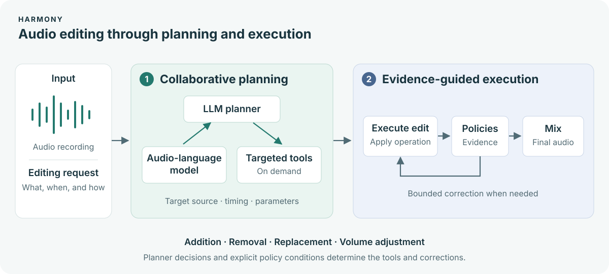

<div align="center">


# Harmony
### Bridging Audio Understanding and Editing through Agentic Collaboration

[Audio Demo](https://christong9.github.io/harmony/) · [Setup](docs/setup.md) · [Architecture](docs/method.md) · [420-case list](data/mmae_420.csv) · [arXiv — forthcoming](#paper)

Addition · Removal · Replacement · Volume adjustment

</div>

Harmony edits an audio file from a natural-language instruction. An LLM planner works with an audio-language model and analysis tools to identify the target and timing, then executes the edit with bounded corrections. The planner selects addition, removal, replacement, or volume adjustment automatically.

## Quick start

Install the command-line interface with **Python 3.10+**:

```bash
git clone https://github.com/ChrisTong9/harmony.git
cd harmony
python -m pip install -e .
```

Prepare the model environments, credentials, and Qwen endpoint using the [setup guide](docs/setup.md), then check the installation:

```bash
export HARMONY_RESOURCE_ROOT=/path/to/resources
harmony doctor --check-service
```

Provide your audio and an editing instruction:

```bash
python -m harmony run \
  --input /path/to/input.wav \
  --instruction "Make the door slamming sound louder." \
  --output-dir outputs/door-volume
```

Use one primary operation per request. Add `--dry-run` to preview the command without model calls, or run `harmony config` to view shared settings. See [example requests](examples/README.md) for all four operations and [setup](docs/setup.md) for endpoint and generation-seed options.

## Output

Each run writes to a fresh output directory. `report.json` identifies the audio output and records execution status, recovery use, and policy decisions; `run_config.json` records configuration and code/resource provenance. Partial edits and unchanged outputs return a nonzero exit status. See [execution policies](docs/corrections.md) for conditions and limits.

## Architecture



Planning resolves the source, timing, and operation parameters. Execution policies organize residual correction, generated-material checks, and optional rendering behind shared stage interfaces. Sound-specific conditions remain explicit in their strategy modules. See the [architecture guide](docs/method.md).

## Repository guide

| Location | Purpose |
|---|---|
| [`harmony/`](harmony/) | CLI, shared configuration, and runtime setup |
| [`audio_edit/`](audio_edit/) | Planning, audio analysis, execution, and tools |
| [`audio_edit/policies/`](audio_edit/policies/) | Ordered execution policies and strategy implementations |
| [`examples/`](examples/) | Commands and instructions for your own audio |
| [`data/mmae_420.csv`](data/mmae_420.csv) | 420 sample IDs, operation labels, and editing instructions |
| [`docs/`](docs/) · [`requirements/`](requirements/) | Setup, architecture, and component dependencies |

The sample list contains metadata only. Audio recordings, generated outputs, and scores are not included.

## Paper

The arXiv link and citation will be added when the preprint is available.

<!-- ARXIV_URL: add the actual https://arxiv.org/abs/... URL after the preprint is public. -->

Questions and contributions: [GitHub Issues](https://github.com/ChrisTong9/harmony/issues) · [Contributing guide](CONTRIBUTING.md). Model weights and third-party components have separate installation and license requirements; see the [license notice](LICENSE-NOTICE.md). A license for Harmony's source has not yet been specified.
