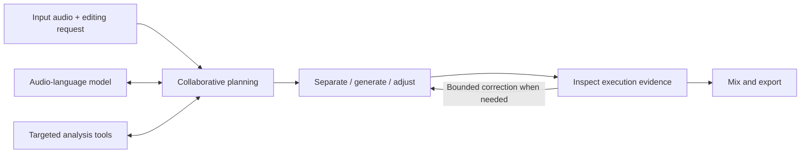

<div align="center">


# Harmony
### Bridging Audio Understanding and Editing through Agentic Collaboration

**Natural-language audio editing with collaborative planning and evidence-guided execution.**

[Audio Demo](https://christong9.github.io/harmony/) · [Quick Start](#quick-start) · [Method](docs/method.md) · [Reproducibility](docs/reproducibility.md) · [arXiv — link forthcoming](#paper)

Addition · Removal · Replacement · Volume adjustment

</div>

Harmony connects an editing request to particular sounds, time regions, and waveform operations. An LLM planner collaborates with an audio-language model and targeted tools to interpret the request, then uses observations of separated or generated audio to decide whether a bounded correction is needed before mixing.

The [interactive demo](https://christong9.github.io/harmony/) contains the original audio and outputs from Harmony and comparison systems. The existing website and its audio files are preserved in this repository.

## How it works



- **Edit-driven collaborative planning (A):** targeted listening questions and tool measurements inform the source, timing, and operation parameters. Tools are available on demand.
- **Evidence-guided execution (B):** observations of the first separated or generated audio can trigger bounded corrections before the final mix. The bounds depend on the execution stage.

Read the [method and code map](docs/method.md) for the implementation entry points.

## Quick start

The command-line interface and numerical table checks require **Python 3.10+** and the standard library only. Run commands from this source checkout.

```bash
git clone https://github.com/ChrisTong9/harmony.git
cd harmony
python -m harmony --help
python -m harmony profiles
python -m harmony tables --out outputs/tables
python -m harmony verify
```

Table reconstruction reads the included numerical records; it makes no model calls. The source release includes 420 examples under each of four configurations, with 72 displayed table values checked against the frozen paper snapshot.

Preview a new edit without loading models:

```bash
python -m harmony run \
  --task volume \
  --input audio/69e8980c910050e59545dd12/input.wav \
  --instruction "Make the door slamming sound louder." \
  --output-dir outputs/door-volume \
  --dry-run
```

For actual inference, follow [model and environment setup](docs/setup.md), provide the Qwen audio endpoint and API credentials, and remove `--dry-run` inside a Slurm GPU allocation. The launcher checks the allocation and runs `nvidia-smi` before inference. See [four task examples](examples/README.md).

## Results in this release

The following values are recomputed from the included v377 numerical records. IFR is instruction following, CR is context preservation, and EMR is exact match; all values are percentages.

| Task | Examples | IFR ↑ | CR ↑ | EMR ↑ |
|---|---:|---:|---:|---:|
| Addition | 115 | 79.14 | 82.00 | 31.30 |
| Removal | 149 | 57.29 | 93.12 | 22.82 |
| Replacement | 79 | 72.24 | 78.34 | 22.78 |
| Volume adjustment | 77 | 35.97 | 95.40 | 9.09 |
| **Pooled** | **420** | **62.18** | **87.71** | **22.62** |

The complete task-level and aggregate configurations are in [Table 4](tables/table4.csv) and [Table 5](tables/table5.csv).

**Reproduction scope.** These are checkpoint-continuation results. The full-system row includes later task repairs; the four rows are not all measurements of one identical source revision with only A/B switches changed. The release preserves those source versions and numerical records. New-input inference uses the selected primary backend and is not expected to reproduce historical outputs or scores exactly. See [provenance and limitations](docs/reproducibility.md).

## Repository guide

| Location | Purpose |
|---|---|
| [`harmony/`](harmony/) | Public CLI, table tools, resource adapters, and task backends |
| [`configs/`](configs/) | Task profiles, runtime paths, and expected table values |
| [`examples/`](examples/) | Four task requests using the existing demo inputs |
| [`results/`](results/) | Frozen per-example numerical scores |
| [`tables/`](tables/) | CSV and LaTeX results |
| [`reproducibility/`](reproducibility/) | Source identities, historical snapshots, and environment observations |
| [`docs/`](docs/) | Setup, method, reproduction, and website instructions |
| [`tests/`](tests/) | CPU-only checks; no model/API calls |
| `index.html`, `app.js`, `audio/` | Existing GitHub Pages demo |

The historical source snapshots are kept for traceability. Start with `harmony/cli.py` and [the code map](docs/method.md) for new edits.

## Development checks

```bash
python -m unittest discover -s tests -v
python scripts/check_release.py
```

These checks verify source hashes, Python syntax, table values, cohort identity, all 16 dry-run profiles, and the Slurm guard. They do not run GPU inference or evaluate new outputs.

## Paper

**arXiv link forthcoming.** This section is reserved for the preprint URL and citation once an identifier is available.

<!-- ARXIV_URL: add the actual https://arxiv.org/abs/... URL after the preprint is public. -->

## Dependencies and licensing

Harmony uses separately installed audio models and tools. Their model weights and third-party repositories are not included. See [setup](docs/setup.md) and the [license notice](LICENSE-NOTICE.md). A license for the Harmony source has not yet been specified.
