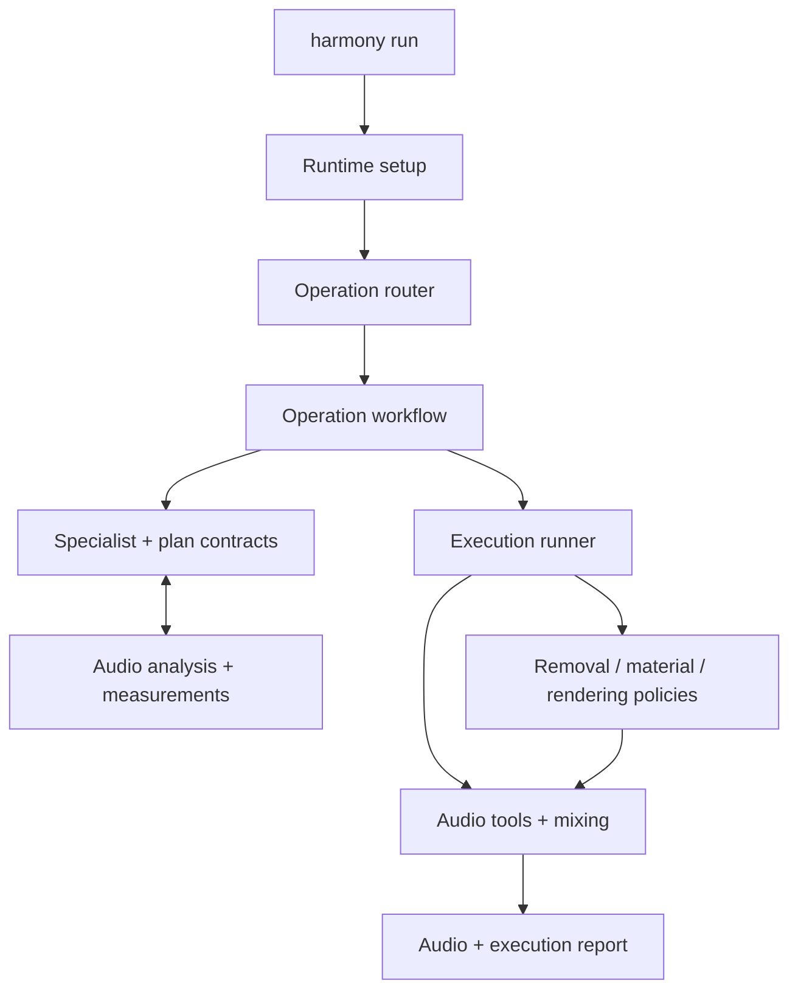

# Architecture

Harmony accepts an audio file and an instruction. The LLM router selects one primary operation: addition, removal, replacement, or volume adjustment. All four operations share model configuration, evidence types, audio tools, and execution-policy interfaces.

## Edit-driven collaborative planning

The LLM planner asks the audio-language model targeted questions about the edit. It can request speech alignment, source separation, activity measurements, or rhythm analysis when the edit depends on those observations.

Evidence is represented as source descriptions, temporal references, and operation constraints. Explicit file times, selected events, and particular participants have different requirements and are resolved by the corresponding planning modules.

## Evidence-guided execution

Execution policies inspect available evidence and apply eligible corrections before mixing. Three policy stages organize removal decisions, generated-material checks, and optional musical rendering. Each stage owns its strategy order and stopping conditions. A strategy owns its applicability checks and permitted action.

A basic execution route is available when the primary route cannot finish. It plans from the original instruction and duration, without the failed route's listening evidence. The report distinguishes this route and preserves partial failures. See [execution policies](corrections.md) for sound-specific conditions, call limits, and outcome reporting.

## Code flow

Start at the CLI and follow the selected operation. Tool adapters and strategy implementations are separate, so changes to decision rules do not require rewriting model subprocess code.

| Location | Responsibility |
|---|---|
| [`harmony/cli.py`](../harmony/cli.py) | Public `config`, `doctor`, and `run` commands |
| [`harmony/runtime/driver.py`](../harmony/runtime/driver.py) | Shared settings, resources, and isolated run directory |
| [`agents/music_edit_agent.py`](../audio_edit/agents/music_edit_agent.py) · [`user_scripts/`](../audio_edit/user_scripts/) | Operation routing and workflow coordination |
| [`specialists/`](../audio_edit/specialists/) · [`plans/`](../audio_edit/plans/) | Planning, source selection, and timeline contracts |
| [`analyzers/`](../audio_edit/analyzers/) | Listening dialogue, speech evidence, and measurements |
| [`runners/`](../audio_edit/runners/) | Separation, generation, and composition workflows |
| [`policies/`](../audio_edit/policies/) | Ordered policy stages, explicit strategies, and trace metadata |
| [`tools/`](../audio_edit/tools/) · [`generators/`](../audio_edit/generators/) | Audio operations and model interfaces |

## Shared settings

[`harmony/configs/defaults.json`](../harmony/configs/defaults.json) defines the common model and runtime settings. `harmony config` displays them. Endpoint and Stable Audio seed overrides apply across operations; they do not make the full pipeline deterministic.

For a focused reading path, inspect [`edit_listening.py`](../audio_edit/analyzers/edit_listening.py) for evidence requests, [`temporal.py`](../audio_edit/plans/temporal.py) for time relations, and [`add_intent.py`](../audio_edit/plans/add_intent.py) for placement contracts. The [setup guide](setup.md) covers installation; the [contributing guide](../CONTRIBUTING.md) covers extending a policy.
